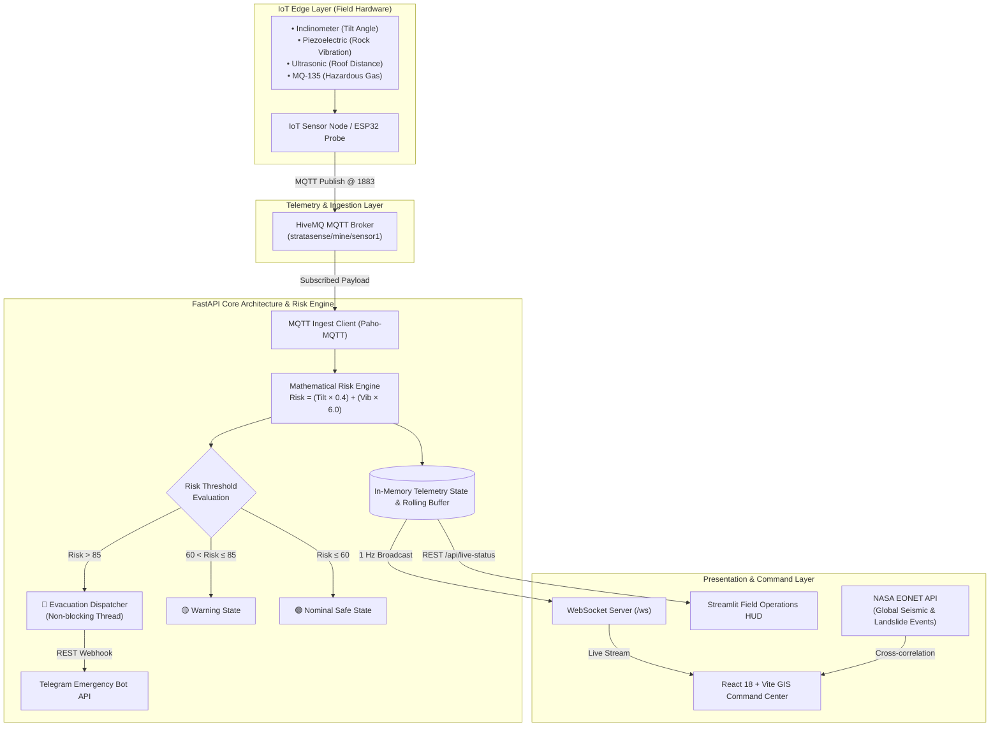

<div align="center">

# 🚨 StrataSense 
### Real-Time IoT Strata Deformation Monitoring & Early Warning Architecture for Underground Mines

[](https://fastapi.tiangolo.com/)
[](https://react.dev/)
[](https://vitejs.dev/)
[](https://www.python.org/)
[](https://mqtt.org/)
[](https://developer.mozilla.org/en-US/docs/Web/API/WebSockets_API)
[](https://leafletjs.com/)
[](https://opensource.org/licenses/MIT)

<p align="center">
  <b>Developed for the Smart India Hackathon (SIH)</b><br>
  <i>An end-to-end full-stack software and telemetry architecture designed to predict roof subsidence, detect toxic mine gases, and trigger sub-second evacuation alerts in critical mining environments.</i>
</p>

---

</div>

## 📌 Executive Summary & SIH Problem Statement

Underground and opencast mining environments face high operational hazards due to **unforeseen strata deformation, rock bursts, roof collapses, and toxic gas leakages**. Traditional monitoring practices rely on manual visual inspections or delayed geological surveys, which often fail to provide actionable evacuation time before catastrophic collapses occur.

**StrataSense** is an industrial-grade, full-stack IoT and software architecture engineered to solve this challenge. It provides:
1. **Continuous Real-Time Ingestion:** Ingests high-frequency sensor readings (angular tilt, seismic vibrations, roof subsidence distance, and toxic gas concentrations) from distributed IoT edge nodes via the **MQTT protocol**.
2. **Deterministic Mathematical Risk Scoring:** Computes instant deformation risk coefficients based on structural strain formulas.
3. **Sub-Second Multi-Channel Alerting:** Automatically fires emergency Telegram webhooks and audio-visual sirens when critical risk thresholds are crossed.
4. **Geospatial Command Center:** Displays interactive OpenStreetMap GIS views, live deformation trend curves, and zone-level risk distributions.

---

## 🏛 System Architecture & Data Flow



---

## ⚡ Core Technical Features & Engineering Highlights

### 1. Mathematical Risk Engine
Strata stability is determined using an empirical weighted risk equation that prioritizes high-frequency seismic acceleration (vibration) combined with continuous baseline displacement (angular tilt):

$$\text{Risk Score} = \text{round}\Big((\theta_{\text{tilt}} \times 0.4) + (v_{\text{vib}} \times 6.0), \, 2\Big)$$

* **$\text{Risk Score} \le 60.0$**: **🟢 SAFE** — Nominal mining operations.
* **$60.0 < \text{Risk Score} \le 85.0$**: **🟡 WARNING** — Geotechnical surveillance alerted; personnel pre-warned.
* **$\text{Risk Score} > 85.0$**: **🔴 DANGER: EVACUATE** — Triggers automated audible alarms and emergency dispatch webhooks.

### 2. Non-Blocking Emergency Dispatch
To ensure that emergency network requests do not block the high-frequency MQTT ingestion loop, alert notifications are decoupled into independent asynchronous worker threads with a 10-second debounce/cool-down timer:
* Dispatches formatted Markdown alerts with immediate telemetry coordinates.
* Prevents broadcast flooding or message starvation during sustained catastrophic deformation events.

### 3. Bidirectional Real-Time Streaming
* **WebSockets (`/ws`):** Emits structured JSON frames at 1 Hz directly to connected web clients, completely avoiding polling overhead.
* **Automatic Reconnect Mechanism:** Custom front-end socket hook (`createLiveSocket`) includes exponential backoff and error recovery for unreliable subterranean connectivity.

### 4. Interactive GIS & NASA EONET Integration
* **Leaflet Spatial Mapping:** Plots active nodes across mining galleries (e.g., Zone A1 Main Extraction Shaft, Zone B2 Secondary Drift).
* **NASA EONET Feed:** Dynamically fetches and correlates external global tectonic activity (earthquakes, landslides) to provide macro-geological context to local mine sensors.

---

## 📂 Repository Structure

```text
stratasense/
├── .gitignore                      # Comprehensive exclusions for build caches & secrets
├── README.md                       # Architecture & technical documentation
│
├── backend/                        # Python / FastAPI Core Engine
│   ├── main.py                     # FastAPI REST API, WebSocket server, MQTT consumer & risk engine
│   ├── dashboard.py                # Ultra-lightweight Streamlit Field Operations HUD
│   ├── simulator.py                # Virtual ESP32 Hardware Emulator (zero-latency testbed)
│   ├── requirements.txt            # Python dependencies (FastAPI, paho-mqtt, Streamlit, etc.)
│   └── .env.example                # Sample environment variables
│
└── frontend/                       # React 18 + Vite Industrial Command Center
    ├── index.html                  # Application entry point
    ├── vite.config.js              # Vite bundler configuration
    ├── package.json                # Frontend dependencies (React, Leaflet, Recharts, Lucide)
    ├── .env.example                # Frontend environment variables
    └── src/
        ├── App.jsx                 # Routing and root layout
        ├── components/             # Reusable UI components
        │   ├── MapView.jsx         # Leaflet GIS interactive mine map
        │   ├── DeformationChart.jsx# Real-time Recharts deformation curve
        │   ├── NasaWidget.jsx      # NASA EONET tectonic event correlation
        │   ├── AlertBanner.jsx     # Dynamic evacuation and hazard warnings
        │   └── HardwareCards.jsx   # Microcontroller & sensor telemetry cards
        ├── hooks/
        │   └── useLiveData.js      # WebSocket state manager with simulation fallback
        ├── pages/
        │   ├── Dashboard.jsx       # Primary operational overview
        │   ├── Analytics.jsx       # Historical sensor analytics
        │   ├── Diagnostics.jsx     # Network and hardware health
        │   ├── Alerts.jsx          # Event log and incident tracking
        │   └── Sensors.jsx         # Granular node metrics
        └── services/
            ├── api.js              # HTTP service layer
            └── websocket.js        # Resilient WebSocket connection manager
```

---

## 🚀 Quick Start & Local Setup

### Prerequisites
* **Python:** 3.10 or higher
* **Node.js:** 18.x or higher
* **Internet Connection:** To connect to the public HiveMQ MQTT broker and OpenStreetMap tiles.

---

### Step 1: Backend Setup (FastAPI & MQTT)

```bash
cd backend

# Create and activate a virtual environment
python -m venv venv
# Windows:
venv\Scripts\activate
# Linux/macOS:
source venv/bin/activate

# Install dependencies
pip install -r requirements.txt

# Configure environment variables
cp .env.example .env

# Run FastAPI Core Gateway (Port 8000)
uvicorn main:app --reload --host 0.0.0.0 --port 8000
```

> **Optional:** To test without physical ESP32 hardware, open a separate terminal and start the simulator:
> ```bash
> python simulator.py
> ```
> To launch the lightweight Field Operations HUD:
> ```bash
> streamlit run dashboard.py
> ```

---

### Step 2: Frontend Setup (React + Vite)

```bash
cd frontend

# Install dependencies
npm install

# Configure environment variables
cp .env.example .env

# Start Vite Development Server
npm run dev
```

Navigate to `http://localhost:5173` in your browser. The Command Center will automatically connect to the WebSocket backend at `ws://localhost:8000/ws`.

---

## 📡 API Reference Summary

| Method | Endpoint | Description |
| :--- | :--- | :--- |
| `GET` | `/` | System identification and gateway health status |
| `GET` | `/api/live-status` | Latest aggregated telemetry snapshot across active nodes |
| `GET` | `/api/sensors` | List of all registered hardware nodes and real-time parameters |
| `GET` | `/api/zones` | Safety status, risk score, and worker counts by mine zone |
| `GET` | `/api/alerts` | Incident history log of threshold breaches |
| `GET` | `/api/health` | Gateway health check and MQTT connectivity verification |
| `WS` | `/ws` | Real-time WebSocket stream (broadcasts at 1 Hz) |

---

## 🛡️ License

This project is licensed under the [MIT License](LICENSE) — free to use, modify, and distribute for educational and commercial purposes.
